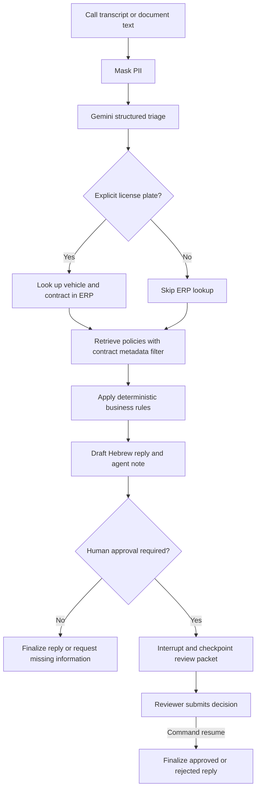

# Automotive Service & Document Triage Agent

An API for triaging Hebrew automotive service calls and documents. It turns customer text into a structured request, checks vehicle and contract records, retrieves relevant service policy, and drafts a Hebrew response. Routine cases complete automatically. High-risk cases pause until a service agent approves or rejects the reply.

## Architecture



- **PII masking before model calls.** The masker replaces Israeli IDs, phone numbers, emails, and credit cards while preserving plates for vehicle lookup. Extraction delimits and escapes customer text. Drafting receives sanitized structured inputs, and the graph scans drafted text again before publication.
- **Repository pattern.** The vehicle repository currently reads seeded SQLite records. The graph depends on a lookup interface that can be implemented by a CRM or ERP adapter.
- **Metadata-filtered hybrid RAG.** The local retriever ranks Markdown policy sections using BM25 and character n-gram TF-IDF. When ERP identifies a contract, only sections marked for that contract or all contracts can rank.
- **Deterministic routing and entitlements.** Business rules determine escalation, missing information, and coverage from extracted facts and ERP data. Gemini writes the reply, with a deterministic fallback if drafting fails.
- **Human review.** LangGraph `interrupt()` saves a review packet under the thread ID. The review endpoint resumes the checkpoint with `Command(resume=...)`.

## Quickstart

Use Python 3.12. From PowerShell in the repository root, create a virtual environment and set `GOOGLE_API_KEY` in the copied `.env` file.

```powershell
py -3.12 -m venv .venv
.\.venv\Scripts\python.exe -m pip install -r requirements.txt
Copy-Item .env.example .env
.\.venv\Scripts\python.exe -m uvicorn src.api.app:app --host 127.0.0.1 --port 8000
```

Open Swagger UI at `http://127.0.0.1:8000/docs`. The `/health` endpoint reports the service as `automotive-service-triage-agent`. On first use, the SQLite repository seeds `data/fleet_mock.db` with synthetic fleet and vehicle records.

To run the same API in Docker with the configured `.env` file:

```powershell
docker build -t automotive-service-triage-agent .
docker run --rm --env-file .env -p 127.0.0.1:8000:8000 automotive-service-triage-agent
```

## API

| Method | Endpoint | Purpose |
| --- | --- | --- |
| GET | `/health` | Check API liveness |
| POST | `/api/v1/triage` | Start a thread and return the decision, final reply, or review packet |
| GET | `/api/v1/triage/{thread_id}` | Read thread status and final reply |
| POST | `/api/v1/triage/{thread_id}/review` | Approve or reject a paused thread, with an optional reply edit |

Submit a Hebrew service request. The examples below use Bash quoting.

```bash
curl -X POST http://127.0.0.1:8000/api/v1/triage \
  -H 'Content-Type: application/json' \
  --data '{"message":"מספר רכב 482-91-302. מתי צריך לעשות טיפול תקופתי?"}'
```

If triage returns `awaiting_human_review`, use its returned thread ID to check status and submit a review.

```bash
THREAD_ID=replace-with-returned-thread-id
curl "http://127.0.0.1:8000/api/v1/triage/$THREAD_ID"
```

```bash
curl -X POST "http://127.0.0.1:8000/api/v1/triage/$THREAD_ID/review" \
  -H 'Content-Type: application/json' \
  --data '{"approved":true,"reviewer_id":"service-agent-7","edited_reply_he":"בדקנו את הפנייה ונציג שירות ייצור איתך קשר."}'
```

## Evaluation

The ten-case Hebrew dataset covers ERP routing, policy ranking and filtering, PII leakage, prompt injection, maintenance relevance, and human-review pause and resume. Offline mode supplies deterministic extraction fixtures and uses the fallback drafter. Live mode uses Gemini for both model calls on the same cases, with credentials from `.env`.

```powershell
.\.venv\Scripts\python.exe -m pytest -v -W error
.\.venv\Scripts\python.exe -m scripts.run_evals
.\.venv\Scripts\python.exe -m scripts.run_evals --live --output evals/last_report.json
.\.venv\Scripts\python.exe -m scripts.test_step3
```

The report includes case and check pass rates and mean and nearest-rank p95 latency. Case timings include graph execution through any simulated review resume. CI requires every offline case to pass and runs without model credentials. Live runs measure model performance, including whether Gemini produced a valid draft before fallback.

## Production deployment

| Local component | Production mapping |
| --- | --- |
| Seeded SQLite repository | Implement the repository interface with Salesforce and/or an ERP REST API |
| Markdown and local hybrid search | Use pgvector or Snowflake Cortex Search with contract metadata filters |
| In-process `MemorySaver` | Use `PostgresSaver` for persistent checkpoints across restarts and replicas |
| Local eval summaries | Send anonymized telemetry and eval logs to Snowflake |
| Local container | Deploy to Azure Container Apps or AWS ECS with managed secrets |

Put the triage and review endpoints behind authentication and authorize reviewer actions by role. Restrict checkpoint access and retention because graph state can contain the original request. The health endpoint checks process liveness independently of Gemini.
